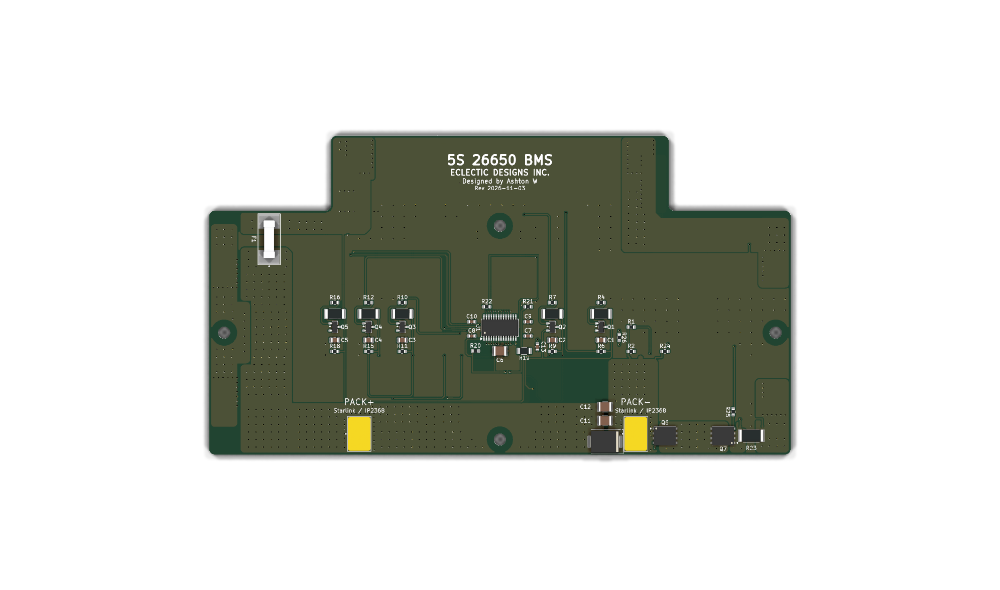
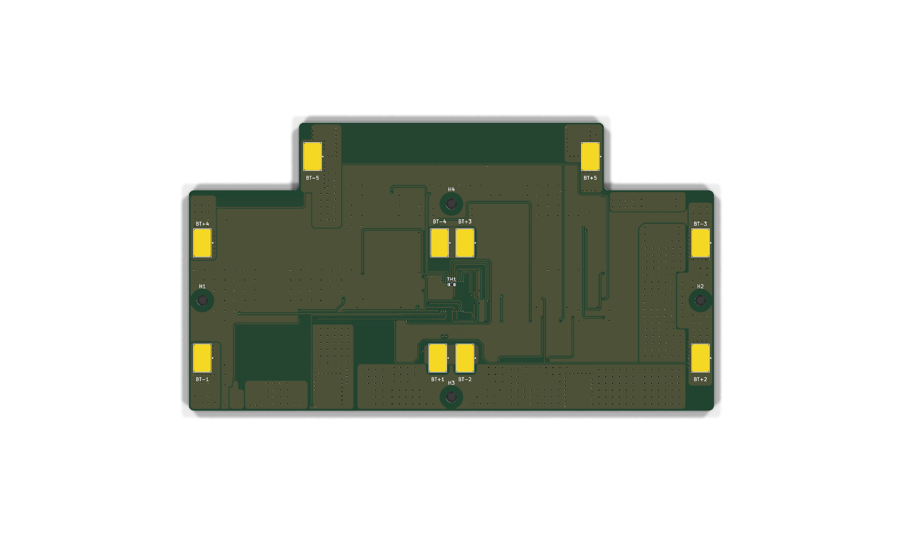

# 5S 26650 BMS for Starlink Mini

A battery management board for a 5-cell (5S) Li-ion 26650 pack that powers a Starlink Mini through an IP2368 USB-C charger/converter module. Designed in KiCad 10.

This board was designed specifically for the [Nexus-2 (Mounted Pack)](https://eclecticdesigns.ca/shop/p/nexus-2) from [eclecticdesigns.ca](https://eclecticdesigns.ca). Its shape, mounting holes and wire-pad positions are laid out for that pack, so check the fit before using it in anything else.

Designed by Ashton W, Eclectic Designs Inc. Board revision: **Rev 2026-11-03**.

| Bottom (components) | Top (cell wire pads) |
|---|---|
|  |  |

> **Lithium battery warning.** A 5S 26650 pack can deliver hundreds of amps into a short and can catch fire if overcharged, shorted, or charged below freezing. This is a hobby design shared as-is, with no warranty. It has not been certified or independently tested. Build and use it at your own risk, never leave a first charge unattended, and follow [docs/TESTING.md](docs/TESTING.md) before connecting real cells.

## Read this first: known issues in this revision

The design files and BOM in this repository are **Rev 2026-11-03 as drawn**. A later design review found two parts that must be substituted when you build it. Both use the existing pads; the PCB does not change.

| Part | As drawn | Fit instead | Why |
|---|---|---|---|
| **U1** | BM3451TJDC-T28A | BM3451**TNDC**-T28A or BM3451**UNDC**-T28A | The TJDC version is obsolete. The others are pin-compatible. |
| **D1** | SMCJ24CA (two-way TVS) | SMCJ24**A** (one-way TVS), **turned 180° from the board marking** | The two-way part lets the FETs see too much voltage when a short is cut off. |

**D1 orientation is safety-critical.** The cathode band must be on the pad connected to PACK+. Fitted the other way round, it shorts the pack. See [docs/ASSEMBLY.md](docs/ASSEMBLY.md).

Other limitations to know about:

- **No cold-charge protection.** The BM3451 has no low-temperature cut-off. Use the IP2368's NTC input with a thermistor on the cells.
- **TH1 is on the board, not on a cell.** Use a leaded thermistor taped to a cell instead.
- **No strain relief** for the battery wires. Glue them down after soldering.
- **No test points.** Probe on component pads.

The full review is in [docs/DESIGN_REVIEW.txt](docs/DESIGN_REVIEW.txt).

## Specifications

| | |
|---|---|
| Cells | 5 in series, Li-ion 26650 (4.2 V full) |
| Protection IC | BYD BM3451 (TSSOP-28) |
| Overcharge cut-off | 4.25 V per cell (TNDC) or 4.235 V (UNDC), 1 s delay |
| Low-voltage cut-off | 2.8 V per cell (TNDC/UNDC), 1 s delay |
| Discharge overcurrent | about 20 A (200 ms), 80 A (4.4 ms), 160 A short circuit (about 300 µs) |
| Charge overcurrent | about 10 A |
| Intended load | about 7 A continuous |
| Cell balancing | passive, about 89 mA per cell, starts at about 4.19 V |
| Over-temperature | charge off at about 45 °C, discharge off at about 62 °C (10 kΩ B3950 NTC) |
| Fuse | Littelfuse 0456025.ER, 25 A, on the positive output |
| Power FETs | 2 × Vishay SiR638ADP (40 V), low side, back to back |
| Current sense | 5 mΩ, 3 W, Kelvin connected |
| Board | 2 layers, 2 oz copper, 1.6 mm, about 155 × 85 mm overall, 4 × M3 holes |

Trip currents come from the BM3451 datasheet thresholds and the 5 mΩ sense resistor; allow about ±15–20%.

## Repository layout

```
hardware/     KiCad 10 project (schematic, PCB, custom footprints, design rules)
production/   Gerbers, BOM and placement file as sent to JLCPCB
docs/         Schematic PDF, board prints, assembly guide, test procedure, design review
```

| File | What it is |
|---|---|
| `hardware/BMS StarLink Mini.kicad_pro` | Open this in KiCad 10 |
| `production/BMS_StarLink_Mini_Gerbers_JLCPCB.zip` | Gerber and drill files |
| `production/BMS_StarLink_Mini_BOM_JLCPCB.csv` / `.xlsx` | BOM with LCSC part numbers |
| `production/BMS_StarLink_Mini_CPL_JLCPCB.csv` | Component placement file |
| `docs/schematic.pdf` | Schematic |
| `docs/pcb-top.pdf`, `docs/pcb-bottom.pdf` | Copper and silkscreen prints (bottom is mirrored, as viewed from the bottom) |
| `docs/ASSEMBLY.md` | Ordering, part substitutions, wiring |
| `docs/TESTING.md` | Bring-up and test procedure |
| `docs/DESIGN_REVIEW.txt` | Review findings and where to buy replacement parts |

## Ordering the board

Settings used for JLCPCB:

- 2 layers, **2 oz outer copper**, **1.6 mm** thickness
- Surface finish: HASL lead-free or ENIG
- Assembly: bottom side (48 parts). TH1 is the only top-side part.

The design rules in the project match JLCPCB's 2 oz limits (0.16 mm track and clearance, 0.2 mm via to track). The board passes DRC with 0 violations and matches the schematic.

When you upload the BOM, change U1 and D1 as described above, or leave both unplaced and solder them by hand. Check the placement preview for rotation of U1, Q1–Q7, D1 and F1 before paying.

## Building and testing

1. Order the board and parts: [docs/ASSEMBLY.md](docs/ASSEMBLY.md)
2. Test the bare board on a bench supply, then with cells: [docs/TESTING.md](docs/TESTING.md)

## Datasheets

- [BYD BM3451](https://www.bydmicro.com/params/field/preview/PDF_PRODUCT_202304141002.pdf)
- [Vishay SiR638ADP](https://www.vishay.com/en/product/75297)

## License

No license has been chosen yet. Until one is added, the files are published for reference only.
